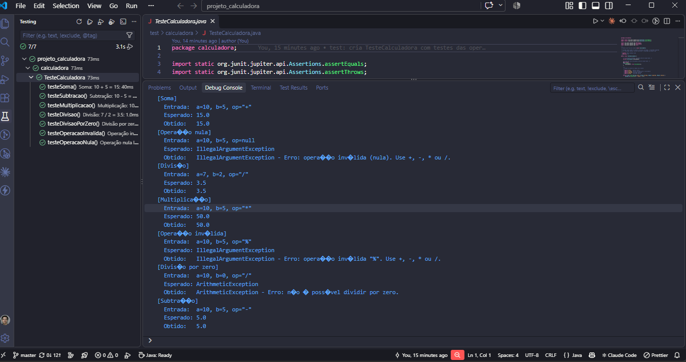
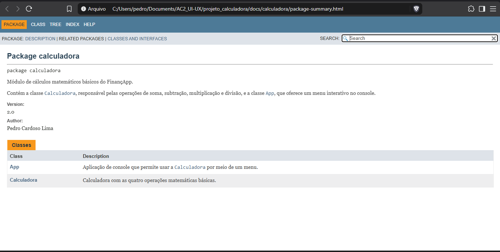

# Projeto Calculadora — FinançApp

> Projeto acadêmico desenvolvido com foco em Qualidade de Software, Testes, Refatoração, Documentação e Versionamento.

---

## 1. Identificação do Projeto

**Projeto:** Projeto Calculadora  
**Contexto:** FinançApp  
**Aluno:** Pedro Cardoso Lima  
**RA:** XXXXXXX  
**Curso:** Nome do curso  
**Disciplina:** Nome da disciplina  
**Professor:** Nome do professor  
**Semestre:** 2026.2  

---

# 2. Visão Geral

O projeto consiste no desenvolvimento de um módulo de cálculos matemáticos básicos em Java para a startup fictícia **FinançApp**.

O módulo foi desenvolvido com o objetivo de ser utilizado futuramente em funcionalidades de controle financeiro, como:

- orçamento mensal;
- divisão de despesas;
- projeções financeiras;
- cálculos auxiliares.

Além do funcionamento correto das operações, o projeto aplica práticas de qualidade de software relacionadas a:

- testes;
- tratamento de erros;
- refatoração;
- documentação;
- versionamento;
- manutenção de código.

---

# 3. Problema

Durante o desenvolvimento da aplicação FinançApp, foi identificada a necessidade de criar um módulo matemático reutilizável.

Entretanto, a equipe definiu que o módulo não deveria apenas funcionar corretamente, mas também apresentar:

- código legível;
- testes automatizados;
- tratamento de falhas;
- documentação técnica;
- controle de versões;
- facilidade de manutenção.

O desafio consiste, portanto, em desenvolver uma solução funcional e ao mesmo tempo aplicar boas práticas de Engenharia de Software.

---

# 4. Objetivo

## 4.1 Objetivo Geral

Desenvolver uma calculadora em Java aplicando práticas de qualidade, testes, documentação, refatoração e versionamento.

## 4.2 Objetivos Técnicos

- implementar operações matemáticas básicas;
- tratar entradas inválidas;
- impedir divisão por zero;
- desenvolver testes automatizados;
- refatorar o código sem alterar seu comportamento;
- documentar classes e métodos com JavaDoc;
- gerar documentação HTML;
- utilizar Git e GitHub;
- organizar commits e branches;
- manter documentação técnica no README.

---

# 5. Escopo Funcional

A aplicação oferece as seguintes operações:

| ID | Funcionalidade | Descrição | Status |
|---|---|---|---|
| RF01 | Soma | Soma dois números inteiros | ✅ |
| RF02 | Subtração | Subtrai dois números inteiros | ✅ |
| RF03 | Multiplicação | Multiplica dois números inteiros | ✅ |
| RF04 | Divisão | Divide dois números inteiros | ✅ |
| RF05 | Validação de divisão | Impede divisão por zero | ✅ |
| RF06 | Operação inválida | Trata operadores não suportados | ✅ |

---

# 6. Requisitos Não Funcionais

| ID | Categoria | Requisito |
|---|---|---|
| RNF01 | Qualidade | O código deve possuir organização e legibilidade |
| RNF02 | Testabilidade | As operações devem possuir testes automatizados |
| RNF03 | Manutenção | O código deve permitir refatoração sem alteração funcional |
| RNF04 | Documentação | Classes e métodos devem possuir JavaDoc |
| RNF05 | Versionamento | O projeto deve utilizar Git e GitHub |
| RNF06 | Confiabilidade | Erros não devem interromper inesperadamente a execução |

---

# 7. Tecnologias Utilizadas

| Tecnologia | Versão | Utilização |
|---|---|---|
| Java | 17 | Desenvolvimento |
| JDK | Eclipse Temurin 17 | Compilação |
| JUnit | 5.11.4 (Jupiter) | Testes |
| Git | 2.55 | Controle de versão |
| GitHub | — | Repositório remoto |
| JavaDoc | 17 | Documentação |
| IDE | Visual Studio Code | Ambiente de desenvolvimento |

---

# 8. Estrutura do Projeto

```text
projeto_calculadora/
│
├── src/
│   └── calculadora/
│       ├── Calculadora.java      # módulo de cálculos (método calc)
│       ├── App.java              # menu interativo no console
│       └── package-info.java     # documentação do pacote
│
├── test/
│   └── calculadora/
│       └── TesteCalculadora.java # testes unitários (JUnit 5)
│
├── lib/
│   └── junit-platform-console-standalone-1.11.4.jar
│
├── docs/
│   └── index.html                # documentação JavaDoc gerada
│
├── images/
│   ├── testes/
│   ├── javadoc/
│   └── refatoracao/
│
├── README.md
├── .gitignore
└── .vscode/settings.json
```

---

# 9. Operações

Todas as operações são feitas pelo método:

```java
public double calc(int primeiroNumero, int segundoNumero, String operador)
```

Os operandos são inteiros e o resultado é `double`, para que a divisão não perca a parte decimal.

| Operador | Operação | Exemplo | Resultado |
|---|---|---|---|
| `+` | Soma | `calc(10, 5, "+")` | `15.0` |
| `-` | Subtração | `calc(10, 5, "-")` | `5.0` |
| `*` | Multiplicação | `calc(10, 5, "*")` | `50.0` |
| `/` | Divisão | `calc(7, 2, "/")` | `3.5` |

---

# 10. Tratamento de Erros

| Situação | Exemplo | Comportamento |
|---|---|---|
| Divisão por zero | `calc(10, 0, "/")` | Lança `ArithmeticException`: *Erro: não é possível dividir por zero.* |
| Operação inválida | `calc(10, 5, "%")` | Lança `IllegalArgumentException`: *Erro: operação inválida "%". Use +, -, \* ou /.* |
| Operação nula | `calc(10, 5, null)` | Lança `IllegalArgumentException` |
| Opção inexistente no menu | digitar `9` | Exibe *Opção inválida. Tente novamente.* |
| Texto no lugar de número | digitar `abc` | Exibe *Entrada inválida. Digite apenas números inteiros.* |

A classe `App` captura todas essas exceções, mostra a mensagem ao usuário e volta ao menu, então o programa não é interrompido.

---

# 11. Testes Unitários

Os testes estão em `test/calculadora/TesteCalculadora.java` e usam JUnit 5. Cada teste exibe no console a **entrada**, o **resultado esperado** e o **resultado obtido**.

| Teste | Entrada | Esperado | Obtido |
|---|---|---|---|
| Soma | `10, 5, "+"` | `15.0` | `15.0` ✅ |
| Subtração | `10, 5, "-"` | `5.0` | `5.0` ✅ |
| Multiplicação | `10, 5, "*"` | `50.0` | `50.0` ✅ |
| Divisão | `7, 2, "/"` | `3.5` | `3.5` ✅ |
| Divisão por zero | `10, 0, "/"` | `ArithmeticException` | `ArithmeticException` ✅ |
| Operação inválida | `10, 5, "%"` | `IllegalArgumentException` | `IllegalArgumentException` ✅ |
| Operação nula | `10, 5, null` | `IllegalArgumentException` | `IllegalArgumentException` ✅ |

**Resultado:** 7 testes executados, 7 aprovados, 0 falhas.

### Como executar os testes

```bash
javac -encoding UTF-8 -d out -cp lib/junit-platform-console-standalone-1.11.4.jar src/calculadora/*.java test/calculadora/*.java
java -jar lib/junit-platform-console-standalone-1.11.4.jar execute -cp out --select-class calculadora.TesteCalculadora
```

No VS Code, também é possível executar pela aba **Testing**.

### Print da execução dos testes



---

# 12. Refatoração

A refatoração foi feita na branch **`Refatoracao`**, a partir do código inicial da branch `master`.

| Técnica | Antes | Depois |
|---|---|---|
| Simplificação de condicionais | Cadeia de `if / else if` em `calc` e no menu | `switch` com setas (Java 17) |
| Extração de métodos | Toda a lógica dentro de `calc` e do `main` | `somar`, `subtrair`, `multiplicar`, `dividir`, `validarDivisor`, `exibirMenu`, `processarOpcao`, `executarOperacao`, `lerInteiro` |
| Melhoria de nomes | `a`, `b`, `op`, `opt`, `n1`, `n2`, `sc` | `primeiroNumero`, `segundoNumero`, `operador`, `opcaoEscolhida`, `entrada` |
| Remoção de duplicação | Leitura dos dois números repetida 4 vezes | Um único método `executarOperacao` |
| Organização lógica | Números "mágicos" (`1`, `5`, `"+"`) | Constantes `OPCAO_SOMA`, `OPCAO_SAIR`, `Calculadora.SOMA` etc. |
| Tratamento de exceções | Dois `catch` com o mesmo código | *multi-catch* e *try-with-resources* no `Scanner` |

**Antes (código inicial):**

```java
if (op.equals("+")) {
    return (double) a + b;
} else if (op.equals("-")) {
    return (double) a - b;
} else if (op.equals("*")) {
    return (double) a * b;
} else if (op.equals("/")) {
    if (b == 0) {
        throw new ArithmeticException("Erro: não é possível dividir por zero.");
    } else {
        return (double) a / b;
    }
} else {
    throw new IllegalArgumentException("Erro: operação inválida \"" + op + "\". Use +, -, * ou /.");
}
```

**Depois (branch `Refatoracao`):**

```java
return switch (operador) {
    case SOMA -> somar(primeiroNumero, segundoNumero);
    case SUBTRACAO -> subtrair(primeiroNumero, segundoNumero);
    case MULTIPLICACAO -> multiplicar(primeiroNumero, segundoNumero);
    case DIVISAO -> dividir(primeiroNumero, segundoNumero);
    default -> throw new IllegalArgumentException(
            "Erro: operação inválida \"" + operador + "\". Use +, -, * ou /.");
};
```

Depois da refatoração, todos os testes foram executados novamente **sem nenhuma alteração** e os 7 continuaram aprovados, o que confirma que o comportamento do sistema foi mantido.


---

# 13. Documentação JavaDoc

O código-fonte possui comentários técnicos e JavaDoc em classes, métodos, atributos, parâmetros, retornos e exceções, usando `@author`, `@version`, `@param`, `@return` e `@throws`.

A documentação HTML foi gerada na pasta `docs/`. Para visualizar, abra o arquivo [`docs/index.html`](docs/index.html) no navegador.

### Como gerar novamente

```bash
javadoc -private -encoding UTF-8 -docencoding UTF-8 -charset UTF-8 -author -version -d docs -sourcepath src -subpackages calculadora
```

### Prints da documentação




---

# 14. Versionamento

| Branch | Conteúdo |
|---|---|
| `master` | Branch principal: código inicial e testes; após o merge, contém também a versão refatorada e documentada |
| `Refatoracao` | Refatoração do código, JavaDoc, documentação HTML e README |

Os commits seguem o padrão *Conventional Commits* (`feat`, `test`, `refactor`, `docs`, `build`, `chore`), separando cada etapa da atividade.

---

# 15. Como Executar a Aplicação

```bash
javac -encoding UTF-8 -d out src/calculadora/*.java
java -cp out calculadora.App
```

No VS Code, também é possível abrir `src/calculadora/App.java` e clicar em **Run**.

---

# 16. Link do Repositório

https://github.com/PedroLima-07/Calculadora
